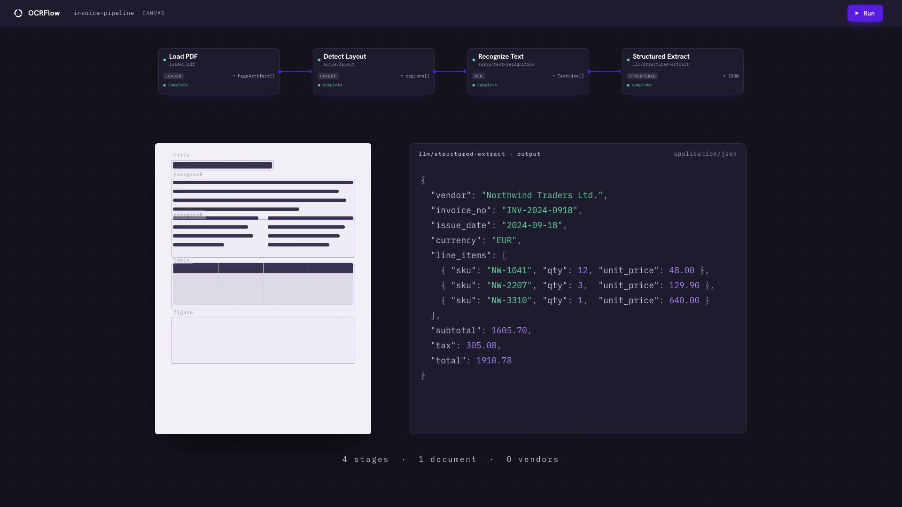

<div align="center">

<picture>
  <source media="(prefers-color-scheme: dark)" srcset="branding/logo-svg/horizontal-reversed.svg">
  <source media="(prefers-color-scheme: light)" srcset="branding/logo-svg/horizontal-primary.svg">
  
</picture>

### Composable OCR pipelines, fully under your control.

Drag open document-AI models onto a canvas, wire them together with typed connections,<br>
and run the exact same graph headless through the API — on your own hardware.

<p>
  <a href="LICENSE"></a>
  <a href="https://github.com/baselhusam/OCRFlow/actions/workflows/ci.yml"></a>
  
  
  
  
</p>

<p>
  <a href="#-quick-start">Quick start</a> ·
  <a href="#-how-it-works">How it works</a> ·
  <a href="#-models">Models</a> ·
  <a href="#-use-it-from-code">API</a> ·
  <a href="#-documentation">Docs</a> ·
  <a href="#-contributing">Contributing</a>
</p>



</div>

---

## Why OCRFlow?

Most document-AI tooling is either a closed SaaS you send your documents to, or a pile of one-off scripts glued around a single library. OCRFlow sits in between:

- **Mix the best model for each step.** Detect layout with Docling, recognize text with Surya, pull tables with Paddle, and extract JSON with a local LLM — in one graph.
- **Catch broken pipelines before they run.** Every wire is typed (`PageArtifact`, `Region[]`, `TextLine[]`, `JSON`, …). Nodes only connect when the output actually fits the next input.
- **Prototype visually, ship headless.** The graph you build on the canvas is the graph the API, batch jobs, and analytics execute. No export step, no rewrite.
- **Keep documents in your building.** The default catalog is open-weight and runs on-prem — NVIDIA, AMD, Apple Silicon, or CPU — including [fully air-gapped](frontend/src/content/docs/air-gapped.md).

---

## 🚀 Quick start

You need **Docker** (Compose v2), **`make`**, and **Git**. GPU drivers are optional.

```bash
git clone https://github.com/baselhusam/OCRFlow.git
cd OCRFlow
cp backend/docker/.env.example backend/docker/.env

make up            # frontend :3000 + API :8000 (no OCR engines yet)
make db-migrate    # apply database migrations
```

Open **http://localhost:3000**, create an account (the email matching `ADMIN_EMAIL` becomes admin), and open a project canvas.

Then start the OCR engines you want. GPUs are detected automatically:

```bash
make detect        # what OS / GPU / compose overlay will be used
make ocr-up        # every engine — or one at a time:
make ocr-docling   # :8102
make ocr-surya     # :8101
make ocr-paddle    # :8103
make ocr-liquid    # :8104
```

Offline engines appear greyed out in the canvas palette and come online as soon as their service reports healthy. `make help` lists every target.

> [!NOTE]
> **Apple Silicon:** Surya, Docling, and Liquid run on the host (PyTorch MPS) rather than in Docker, and Paddle runs in Docker on CPU. `make ocr-up` handles this for you. See [GPU & accelerators](frontend/src/content/docs/gpu.md).

<details>
<summary><b>Host-based development (no Docker for the app)</b></summary>

<br>

Requires Python 3.11+, Node.js 20+, PostgreSQL 14+, and Redis 6+.

```bash
# Backend
cd backend
python -m venv .venv && source .venv/bin/activate
pip install -r requirements.txt            # + requirements-docling.txt / requirements-surya.txt
cp .env.example .env                       # DATABASE_URL, REDIS_URL, secrets, …
alembic upgrade head
uvicorn app.main:app --reload              # API on :8000

# Background worker (second terminal)
celery -A app.celery_app:celery_app worker --loglevel=info

# Frontend (third terminal)
cd frontend
npm install
cp .env.local.example .env.local
npm run dev                                # app on :3000
```

The same steps are wrapped as `make install`, `make be-api`, `make be-worker`, and `make fe-dev`. Full details in [Installation](frontend/src/content/docs/installation.md).

</details>

---

## 🧭 How it works

```
                    ┌──────────────── control plane ────────────────┐
  Next.js canvas ──►│  FastAPI gateway · Celery worker              │
  REST / API keys ─►│  PostgreSQL · Redis                           │
                    └──────────────────────┬────────────────────────┘
                                           │ typed JSON over HTTP
                    ┌──────────────── data plane (opt-in) ──────────┐
                    │  Surya :8101 · Docling :8102 · Paddle :8103   │
                    │  Liquid :8104 · Ollama :11434 · hosted LLMs   │
                    └───────────────────────────────────────────────┘
```

`make up` starts only the control plane. Each OCR engine is its own microservice that loads weights lazily on first use, so you ship and run only what you need. The gateway never imports PyTorch; it forwards typed requests to whichever provider owns the model.

You work with three objects:

| Object | What it's for |
| --- | --- |
| **Project** | A free-form canvas for experimenting. Drop in a PDF or image loader, run one node or the whole graph, preview regions and text. |
| **Pipeline** | A reusable graph with a defined input and output, promoted from a project canvas. Pipelines can be nested as nodes in other canvases. |
| **Job** | A pipeline run over many documents at once, with a per-document trace. |

A few design rules keep graphs composable:

- **Atomic tasks.** One node = one task = one endpoint. Docling's layout model and Docling's OCR are separate nodes, so you can swap either one independently.
- **Adapter, don't fork.** Runners wrap upstream inference instead of reimplementing it; weights and licenses stay with the provider.
- **Collections are first-class.** Run a page-level node across every page of a document, or fan a list out through an **Items** node.

More in [How OCRFlow works](frontend/src/content/docs/concepts.md).

---

## 🧩 Models

The catalog is task-level. Everything below runs today; more providers (Tesseract, RapidOCR, docTR, Florence-2, …) are listed in the registry as planned.

| Provider | Port | What it gives you | License |
| --- | --- | --- | --- |
| **Loaders** | — | PDF → pages, image → page, pick a page | MIT |
| **[Docling](frontend/src/content/docs/docling.md)** | `8102` | Layout (Heron), OCR, TableFormer, figure classification & captioning, formulas, Granite-Docling VLM, full convert | MIT code · Apache-2.0 weights |
| **[Surya](frontend/src/content/docs/surya.md)** | `8101` | Layout, text detection & recognition, reading order, tables, LaTeX OCR | GPL-3.0 code · OpenRAIL-M weights ⚠️ |
| **[Paddle](frontend/src/content/docs/paddle.md)** | `8103` | DocLayout, PP-OCR text recognition, PP-Structure | Apache-2.0 |
| **[Liquid AI](frontend/src/content/docs/liquid.md)** | `8104` | LFM2.5-VL-1.6B: prompted vision and schema-validated extraction | LFM Open License v1.0 |
| **Ollama** | `11434` | Local Qwen3 0.6B / Qwen3.5 0.8B for text and vision prompts and structured JSON | Apache-2.0 |
| **Connected LLM / VLM** | — | OpenAI, Anthropic, or any compatible endpoint for prompts and structured extraction | Provider terms |

Structured-extraction nodes take a schema you build field by field (or start from an Invoice / Receipt preset), and every output is validated before it moves downstream.

> [!WARNING]
> Surya's code is GPL-3.0. Check license compatibility before shipping it inside a proprietary product.

Full list with IDs, inputs, and outputs: [Model catalog](frontend/src/content/docs/models.md) · [`backend/docs/MODEL_CATALOG.md`](backend/docs/MODEL_CATALOG.md).

---

## 🔌 Use it from code

Anything built on the canvas runs headless. Admins and Developer users can create API keys in **Account & settings → API keys**, then send documents to any pipeline:

```python
import requests

BASE = "http://localhost:8000/api/v1"
headers = {"X-API-Key": "ocrflow_..."}  # read this from an env var in real code

pipeline_id = requests.get(f"{BASE}/developer/pipelines", headers=headers).json()["items"][0]["id"]

with open("invoice.pdf", "rb") as f:
    queued = requests.post(
        f"{BASE}/developer/pipelines/{pipeline_id}/documents",
        headers=headers,
        files=[("files", ("invoice.pdf", f, "application/pdf"))],
        data={"output_format": "json"},
    )
run_id = queued.json()["runs"][0]["id"]

result = requests.get(f"{BASE}/developer/pipelines/{pipeline_id}/runs/{run_id}", headers=headers).json()
```

Uploads accept up to 50 files per request. Interactive OpenAPI docs are served at **http://localhost:8000/docs**, and the full route list is in the [API reference](frontend/src/content/docs/api.md).

---

## 📚 Documentation

The full docs ship inside the app at **http://localhost:3000/documentation** (press <kbd>⌘K</kbd> to search). The sources live in [`frontend/src/content/docs/`](frontend/src/content/docs/):

| | |
| --- | --- |
| **Get started** | [Quick start](frontend/src/content/docs/quick-start.md) · [Installation](frontend/src/content/docs/installation.md) · [GPU & accelerators](frontend/src/content/docs/gpu.md) · [Air-gapped deploy](frontend/src/content/docs/air-gapped.md) |
| **Concepts** | [How it works](frontend/src/content/docs/concepts.md) · [Projects](frontend/src/content/docs/projects.md) · [Pipelines](frontend/src/content/docs/pipelines.md) · [Jobs](frontend/src/content/docs/jobs.md) · [Input & output](frontend/src/content/docs/input-output.md) |
| **Guides** | [Canvas](frontend/src/content/docs/canvas.md) · [Connecting nodes](frontend/src/content/docs/connecting-nodes.md) · [Connect models](frontend/src/content/docs/connect-models.md) · [Running jobs](frontend/src/content/docs/running-jobs.md) · [Analytics](frontend/src/content/docs/analytics.md) · [Admin](frontend/src/content/docs/admin.md) |
| **Reference** | [Make commands](frontend/src/content/docs/commands.md) · [API](frontend/src/content/docs/api.md) · [Environment variables](frontend/src/content/docs/environment.md) · [Keyboard shortcuts](frontend/src/content/docs/keyboard-shortcuts.md) |

---

## 🛠️ Development

```bash
make test          # backend pytest (non-GPU) + frontend vitest
make fe-lint       # eslint
make logs          # follow all container logs
make ocr-ps        # which OCR engines are up
make down          # stop the stack (make ocr-down for engines)
```

<details>
<summary><b>Repository layout</b></summary>

```
OCRFlow/
├── backend/                 FastAPI gateway, model runners, Celery worker
│   ├── app/                   API, model registry, runners, schemas, db
│   ├── alembic/               database migrations
│   ├── docker/                Dockerfiles, compose overlays, env example
│   ├── docs/                  model catalog, containerized serving, air-gapped notes
│   ├── tests/                 pytest suite
│   └── requirements*.txt      core / dev / docling / surya / paddle / liquid
├── frontend/                Next.js 16 app (React 19, React Flow, Tailwind v4, shadcn/ui)
│   └── src/content/docs/      in-app documentation
├── branding/                logos, brand guidelines, design system
├── scripts/                 accelerator detection, host OCR runner
├── docker-compose.yml       full-stack compose entrypoint
└── Makefile                 every dev and ops command (make help)
```

</details>

| Layer | Stack |
| --- | --- |
| Frontend | Next.js 16, React 19, TypeScript, React Flow, Tailwind CSS v4, shadcn/ui, Framer Motion, Recharts |
| Backend | FastAPI, SQLAlchemy 2 (async), Alembic, Pydantic, Celery |
| Data | PostgreSQL, Redis |
| Inference | Docling, Surya, PaddleOCR, Transformers, Ollama — each in its own service |

---

## 🗺️ Roadmap

- [x] Typed canvas with project → pipeline → job promotion
- [x] Docling, Surya, Paddle, Liquid, Ollama, and hosted LLM/VLM providers
- [x] Auto-detected NVIDIA / AMD / Apple GPU serving and air-gapped deploys
- [x] Developer API keys, per-key usage, workspace and admin analytics
- [x] Collections: apply-to-all-pages, Items fan-out, structured schema builder
- [ ] Server-side map and fan-in for collections
- [ ] More standalone engines (Tesseract, RapidOCR, docTR, Florence-2, …)
- [ ] Export nodes and pipeline presets

---

## 🤝 Contributing

Contributions are welcome. Read [CONTRIBUTING.md](CONTRIBUTING.md) for setup and conventions, and open an issue before large changes. New models follow the per-task checklist in [`backend/docs/MODEL_CATALOG.md`](backend/docs/MODEL_CATALOG.md): each task gets its own endpoint, schemas, validation, and tests.

Please follow the [Code of Conduct](CODE_OF_CONDUCT.md), and report vulnerabilities privately as described in [SECURITY.md](SECURITY.md).

---

## 📄 License

OCRFlow is released under the [MIT License](LICENSE). Model weights and upstream libraries keep their own licenses — see the [model table](#-models).

<div align="center">
<br>
<sub>Built by <a href="https://github.com/baselhusam">Basel Husam</a> · Brand and design system in <a href="branding/"><code>branding/</code></a></sub>
</div>
