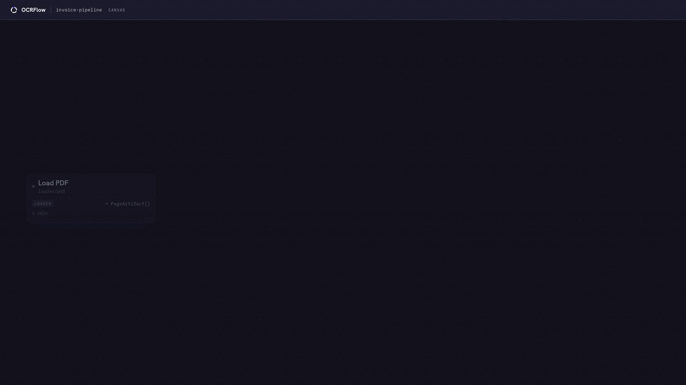
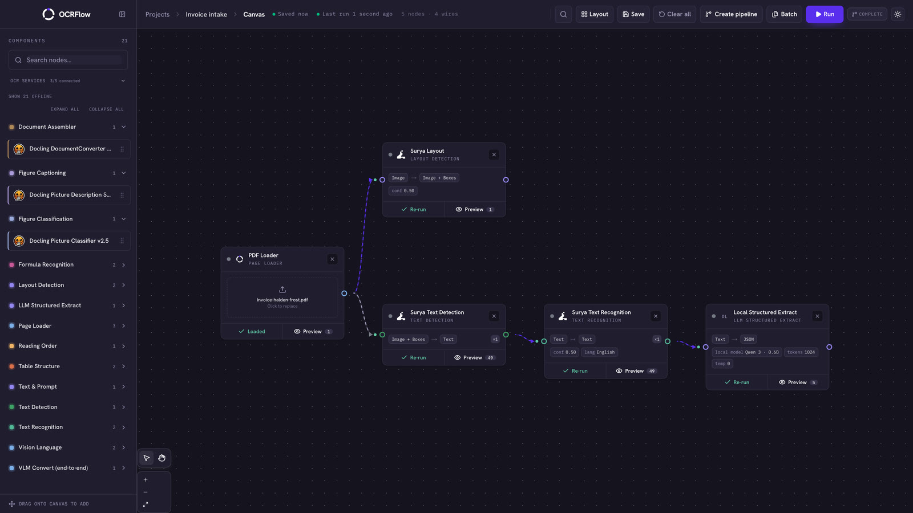
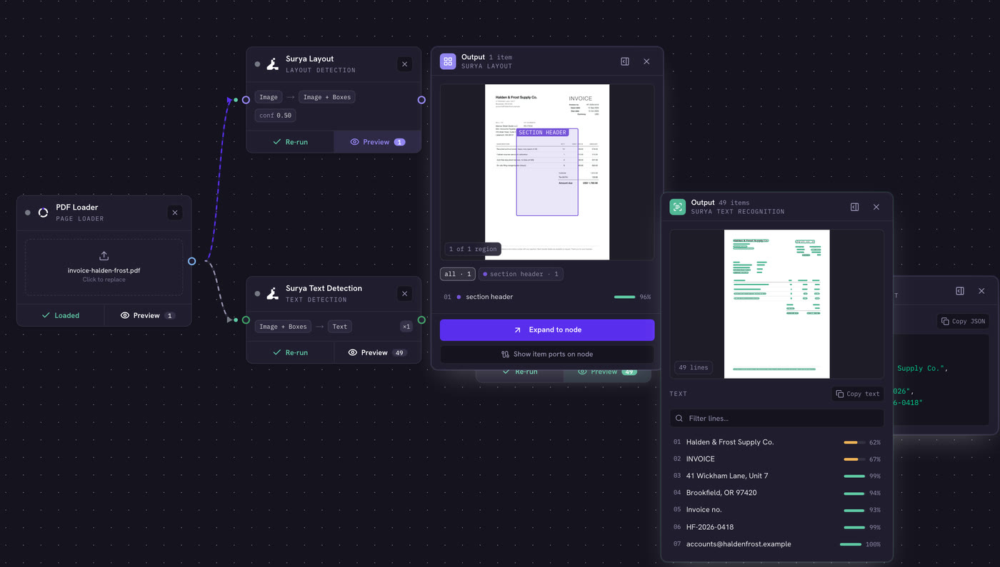
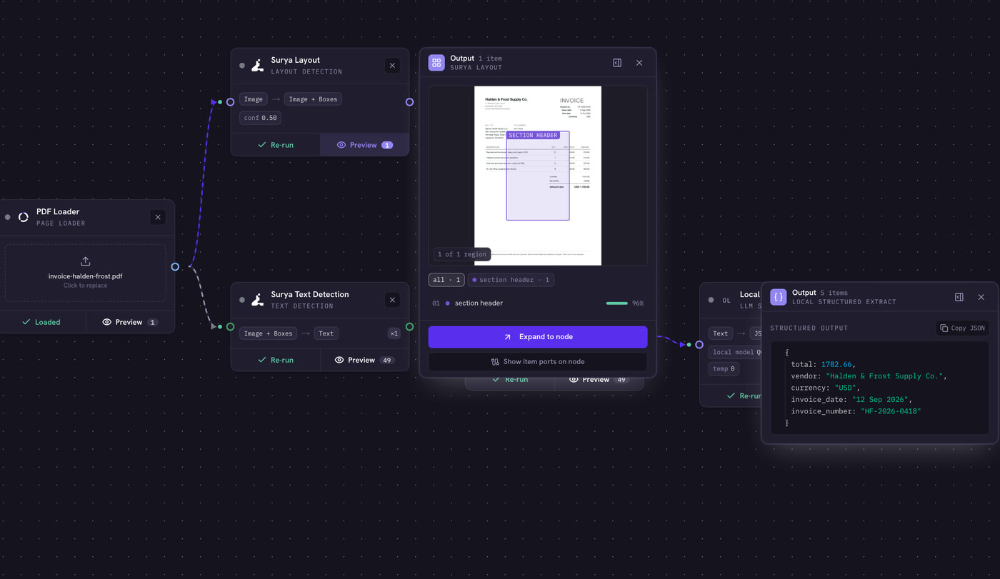
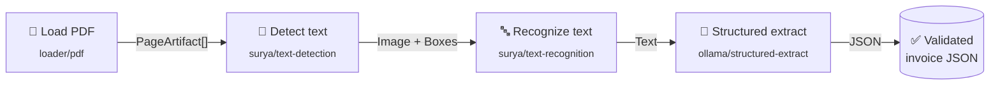
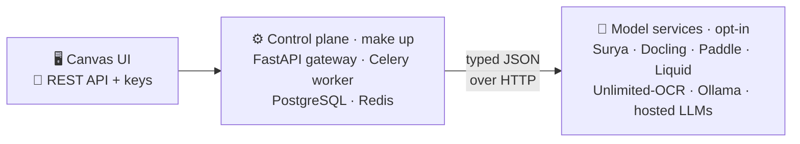

<div align="center">

<picture>
  <source media="(prefers-color-scheme: dark)" srcset="branding/logo-svg/horizontal-reversed.svg">
  <source media="(prefers-color-scheme: light)" srcset="branding/logo-svg/horizontal-primary.svg">
  
</picture>

## The open-source canvas for document AI

**Drag open OCR models onto a canvas, wire them together, and turn any PDF into validated JSON.**<br>
**Then call the exact same pipeline from your code. Runs on your hardware, and your documents never leave it.**

<p>
  <a href="LICENSE"></a>
  <a href="https://github.com/baselhusam/OCRFlow/actions/workflows/ci.yml"></a>
  <a href="https://github.com/baselhusam/OCRFlow/releases"></a>
  
  
</p>

<p>
  <a href="https://baselhusam.github.io/OCRFlow/"><b>Website</b></a> ·
  <a href="#-quick-start"><b>Quick start</b></a> ·
  <a href="#-see-it-in-action">Screenshots</a> ·
  <a href="#-how-it-works">How it works</a> ·
  <a href="#-models">Models</a> ·
  <a href="#-use-it-from-code">API</a> ·
  <a href="#-documentation">Docs</a> ·
  <a href="#-roadmap">Roadmap</a> ·
  <a href="#-contributing">Contributing</a>
</p>



<sub><b>PDF in, typed JSON out.</b> Layout and text from Surya, fields from an LLM. Every step is a node you can swap.</sub>

</div>

<br>

> [!TIP]
> **Three commands to a running canvas:** `git clone` → `make up` → open `localhost:3000`. [Jump to Quick start ↓](#-quick-start)

---

## ✨ Why OCRFlow?

Document AI today means picking between a **closed cloud API** that sees every invoice, contract, and medical record you send it, or a **pile of glue scripts** wrapped around one library. OCRFlow gives you the open models and the tooling around them in one place.

<table>
<tr>
<td width="50%" valign="top">

### 🧩 Best model for every step
Detect layout with **Docling**, read text with **Surya**, parse tables with **PaddleOCR**, and extract fields with **Qwen** or **GPT**, all in one graph. Not happy with a step? Swap the node; the rest of the pipeline stays put.

</td>
<td width="50%" valign="top">

### 🔌 Typed wires, no silent breakage
Every port carries a type: `PageArtifact`, `Region[]`, `TextLine[]`, `JSON`. Nodes only connect when the output actually fits the next input, so broken pipelines are caught while you draw them, not in production.

</td>
</tr>
<tr>
<td width="50%" valign="top">

### 👀 See every intermediate result
Click any node to preview what it produced: layout boxes over the page, recognized lines with confidence, the final JSON. Debugging OCR stops being guesswork.

</td>
<td width="50%" valign="top">

### 🚢 Prototype visually, ship headless
The graph on the canvas *is* the production pipeline. Promote it, grab an API key, and `POST` documents to it. Batch jobs and per-document traces come for free.

</td>
</tr>
<tr>
<td width="50%" valign="top">

### 🔒 Your documents stay home
All default models are open-weight and run on your own machines. NVIDIA, AMD, and Apple Silicon GPUs are detected automatically, and the whole stack can run [fully air-gapped](frontend/src/content/docs/air-gapped.md).

</td>
<td width="50%" valign="top">

### 🧱 Schema-validated output
Build an extraction schema field by field (or start from the Invoice or Receipt preset). Every LLM/VLM response is validated before it moves downstream. No more "the model returned prose instead of JSON".

</td>
</tr>
</table>

### How it compares

| | Cloud OCR APIs | DIY scripts | **OCRFlow** |
| --- | :---: | :---: | :---: |
| Documents stay on your infrastructure | ❌ | ✅ | ✅ |
| Mix models from different projects per step | ❌ | 🟡 lots of glue code | ✅ drag and drop |
| Inspect the output of every step | 🟡 | ❌ | ✅ |
| REST API, API keys, batch jobs | ✅ | ❌ build it yourself | ✅ |
| Cost per page | 💸 metered | free | free |
| Works with no internet | ❌ | 🟡 | ✅ |

---

## 📸 See it in action

<table>
<tr>
<td colspan="2"></td>
</tr>
<tr>
<td colspan="2" align="center"><sub><b>The canvas.</b> 30+ nodes in the palette, typed wires, and per-node run, re-run, and preview.</sub></td>
</tr>
<tr>
<td width="50%"></td>
<td width="50%"></td>
</tr>
<tr>
<td align="center"><sub><b>Inspect every step.</b> Layout regions and recognized lines with confidence.</sub></td>
<td align="center"><sub><b>Get JSON.</b> Schema-validated fields from a local model.</sub></td>
</tr>
</table>

---

## 🚀 Quick start

You need **Docker** (Compose v2), **`make`**, and **Git**. A GPU is optional.

**1. Clone and configure**

```bash
git clone https://github.com/baselhusam/OCRFlow.git && cd OCRFlow
cp backend/docker/.env.example backend/docker/.env
echo "ADMIN_EMAIL=you@example.com" >> backend/docker/.env   # your email: this account becomes the admin
```

**2. Start the app**

```bash
make up            # web app on :3000, API on :8000
make db-migrate    # set up the database
```

Open **http://localhost:3000** and sign up with the email you set as `ADMIN_EMAIL`.

**3. Start OCR engines**

Your OS and GPU are detected automatically:

```bash
make ocr-up        # start every engine
make ocr-docling   # ...or pick and choose: Docling :8102
make ocr-surya     # Surya :8101
make ocr-paddle    # PaddleOCR :8103
make ocr-liquid    # Liquid AI :8104
make ocr-unlimited # Baidu Unlimited-OCR :8105 (Apple Silicon: run make ocr-unlimited-setup once)
```

Engines that aren't running show up greyed out in the canvas palette and light up as soon as they report healthy. Weights download on first use, so the first run of each model takes a few minutes. Check what's up with `make ocr-ps`, see which GPU overlay will be used with `make detect`, and list every command with `make help`.

**4. Build your first pipeline.** In **Projects**, create a project, upload a PDF, and chain *PDF Loader* → *Surya Text Detection* → *Surya Text Recognition* → *Structured Extract* on the canvas. Run it and click any node to see its output.

### Where each engine runs

| Host | Docling · Surya · Liquid | PaddleOCR | Unlimited-OCR |
| --- | --- | --- | --- |
| Linux / Windows (WSL2) + NVIDIA | Docker, CUDA | Docker, CUDA | Docker, CUDA (Transformers or vLLM) |
| Linux + AMD | Docker, ROCm | Docker, CPU | not supported |
| macOS Apple Silicon | host process, MPS | Docker, CPU | host process, MLX |
| Anything else | Docker, CPU | Docker, CPU | not supported |

`make ocr-up` picks the right column for you. Override it with `ACCELERATOR=cpu|nvidia|amd|mlx`. Details in [GPU & accelerators](frontend/src/content/docs/gpu.md).

> [!NOTE]
> **On Windows?** Run OCRFlow from a WSL2 shell with Docker Desktop's WSL integration turned on. `make` and the helper scripts expect a POSIX shell, and NVIDIA GPUs pass through to Docker under WSL2.

<details>
<summary><b>Run without Docker (host-based development)</b></summary>

<br>

Requires Python 3.11+, Node.js 20+, PostgreSQL 14+, and Redis 6+.

```bash
# Backend
cd backend
python -m venv .venv && source .venv/bin/activate
pip install -r requirements.txt            # + requirements-docling.txt / requirements-surya.txt
cp .env.example .env                       # DATABASE_URL, REDIS_URL, secrets, ...
alembic upgrade head
uvicorn app.main:app --reload              # API on :8000

# Background worker (second terminal)
celery -A app.celery_app:celery_app worker --loglevel=info

# Frontend (third terminal)
cd frontend
npm install
cp .env.local.example .env.local
npm run dev                                # app on :3000
```

The same steps are wrapped as `make install`, `make be-api`, `make be-worker`, and `make fe-dev`. Full details in [Installation](frontend/src/content/docs/installation.md).

</details>

---

## 🧭 How it works

A pipeline is a graph of **atomic tasks**. Each node does one thing, and each wire carries a typed value:



Under the hood, a lightweight control plane orchestrates independent model services. The gateway never imports PyTorch; it forwards typed requests to whichever engine owns the model, and each engine loads its weights only when first used. You run only what you need.



You work with three objects:

| Object | What it's for |
| --- | --- |
| **Project** | A free-form canvas for experimenting. Drop in a PDF or image, run one node or the whole graph, preview regions and text. |
| **Pipeline** | A reusable graph with a defined input and output, promoted from a project. Pipelines can be nested as nodes inside other canvases. |
| **Job** | A pipeline run over many documents at once, with a per-document trace. |

Collections are first-class: run a page-level node across every page of a document, or fan a list out through an **Items** node. More in [How OCRFlow works](frontend/src/content/docs/concepts.md).

---

## 🧠 Models

**30+ ready-to-run nodes across 7 engines**, with more providers (Tesseract, RapidOCR, docTR, Florence-2, ...) already in the registry as planned.

| Engine | What you get | License |
| --- | --- | --- |
| **[Docling](frontend/src/content/docs/docling.md)** (IBM) | Layout (Heron), OCR, TableFormer, figure classification and captioning, formulas, Granite-Docling VLM, full document convert | MIT code · Apache-2.0 weights |
| **[Surya](frontend/src/content/docs/surya.md)** | Layout, text detection and recognition, reading order, tables, LaTeX OCR | GPL-3.0 code · OpenRAIL-M weights ⚠️ |
| **[PaddleOCR](frontend/src/content/docs/paddle.md)** | DocLayout, PP-OCR text recognition, PP-Structure | Apache-2.0 |
| **[Liquid AI](frontend/src/content/docs/liquid.md)** | LFM2.5-VL-1.6B for prompted vision and schema-validated extraction | LFM Open License v1.0 |
| **[Unlimited-OCR](frontend/src/content/docs/unlimited.md)** (Baidu) | End-to-end page parsing (text, tables, LaTeX, layout) and one-pass multi-page reading. Apple Silicon (MLX) or NVIDIA | MIT |
| **Ollama** | Local Qwen3 0.6B and Qwen3.5 0.8B for text and vision prompts and structured JSON | Apache-2.0 |
| **Connected LLM / VLM** | OpenAI, Anthropic, or any OpenAI-compatible endpoint for prompts and structured extraction | Provider terms |
| **Loaders** | PDF to pages, image to page, pick a page | MIT |

> [!WARNING]
> Surya's code is GPL-3.0. Check license compatibility before shipping it inside a proprietary product.

Full list with IDs, inputs, and outputs: [Model catalog](frontend/src/content/docs/models.md) · [`backend/docs/MODEL_CATALOG.md`](backend/docs/MODEL_CATALOG.md).

---

## 💡 What people build with it

- **Invoices and receipts to JSON.** Vendor, totals, and line items, validated against your schema.
- **Scanned archives to searchable text.** Batch thousands of pages through a job and keep a trace per document.
- **Scientific papers to Markdown and LaTeX.** Layout, reading order, tables, and formulas in one graph.
- **Model bake-offs.** Run Surya, Docling, and Paddle side by side on your own documents before you commit to one.
- **Regulated and offline environments.** Healthcare, legal, finance, or government work where documents can't touch a third-party API.

---

## 🔌 Use it from code

Anything built on the canvas runs headless. Create an API key in **Account & settings → API keys**, then send documents to any pipeline:

<table>
<tr><td><b>Python</b></td></tr>
<tr><td>

```python
import os, time, requests

BASE = "http://localhost:8000/api/v1/developer"
headers = {"X-API-Key": os.environ["OCRFLOW_API_KEY"]}

# 1. Pick a pipeline
pipeline_id = requests.get(f"{BASE}/pipelines", headers=headers).json()["items"][0]["id"]

# 2. Upload a document
with open("invoice.pdf", "rb") as f:
    queued = requests.post(
        f"{BASE}/pipelines/{pipeline_id}/documents",
        headers=headers,
        files=[("files", ("invoice.pdf", f, "application/pdf"))],
        data={"output_format": "json"},
    ).json()

# 3. Poll until it finishes
run_url = f"{BASE}/pipelines/{pipeline_id}/runs/{queued['runs'][0]['id']}"
run = requests.get(run_url, headers=headers).json()
while run["status"] in ("queued", "running"):
    time.sleep(1)
    run = requests.get(run_url, headers=headers).json()

print(run["status"], run["result"])
```

</td></tr>
<tr><td><b>curl</b></td></tr>
<tr><td>

```bash
curl -s -H "X-API-Key: $OCRFLOW_API_KEY"   -F "files=@invoice.pdf" -F "output_format=json"   http://localhost:8000/api/v1/developer/pipelines/$PIPELINE_ID/documents

curl -s -H "X-API-Key: $OCRFLOW_API_KEY"   http://localhost:8000/api/v1/developer/pipelines/$PIPELINE_ID/runs/$RUN_ID
```

</td></tr>
</table>

Send up to 50 files per request. Each upload returns a `job_id`, so you can track the whole batch at `GET /jobs/{job_id}` or each file through its run. Interactive OpenAPI docs live at **http://localhost:8000/docs**, and every route is listed in the [API reference](frontend/src/content/docs/api.md).

---

## 📚 Documentation

The full docs ship inside the app at **http://localhost:3000/documentation** (press <kbd>⌘K</kbd> to search). Sources live in [`frontend/src/content/docs/`](frontend/src/content/docs/):

| | |
| --- | --- |
| **Get started** | [Quick start](frontend/src/content/docs/quick-start.md) · [Installation](frontend/src/content/docs/installation.md) · [GPU & accelerators](frontend/src/content/docs/gpu.md) · [Air-gapped deploy](frontend/src/content/docs/air-gapped.md) |
| **Concepts** | [How it works](frontend/src/content/docs/concepts.md) · [Projects](frontend/src/content/docs/projects.md) · [Pipelines](frontend/src/content/docs/pipelines.md) · [Jobs](frontend/src/content/docs/jobs.md) · [Input & output](frontend/src/content/docs/input-output.md) |
| **Guides** | [Canvas](frontend/src/content/docs/canvas.md) · [Connecting nodes](frontend/src/content/docs/connecting-nodes.md) · [Connect models](frontend/src/content/docs/connect-models.md) · [Running jobs](frontend/src/content/docs/running-jobs.md) · [Analytics](frontend/src/content/docs/analytics.md) · [Admin](frontend/src/content/docs/admin.md) |
| **Reference** | [Make commands](frontend/src/content/docs/commands.md) · [API](frontend/src/content/docs/api.md) · [Environment variables](frontend/src/content/docs/environment.md) · [Keyboard shortcuts](frontend/src/content/docs/keyboard-shortcuts.md) |

<details>
<summary><b>❓ FAQ</b></summary>

<br>

**Do I need a GPU?**<br>
No. Everything except Unlimited-OCR has a CPU path, and smaller models (Qwen3 0.6B, PP-OCR) are quick on CPU. With an NVIDIA, AMD, or Apple Silicon GPU, OCRFlow detects it and uses it automatically.

**Does any data leave my machine?**<br>
Not unless you add a node that calls a hosted provider like OpenAI or Anthropic. The default catalog is entirely local, and the stack runs [air-gapped](frontend/src/content/docs/air-gapped.md).

**Can I bring my own model?**<br>
Yes. Point a Connected LLM/VLM node at any OpenAI-compatible endpoint (vLLM, LM Studio, llama.cpp server, ...). To add a new engine as first-class nodes, follow the per-task checklist in [`MODEL_CATALOG.md`](backend/docs/MODEL_CATALOG.md).

**Something isn't showing up in the palette.**<br>
Run `make ocr-ps` to see which engines are healthy and `make ocr-logs` to follow their logs. The gateway's view of every provider is at `GET http://localhost:8000/api/v1/models/runtime`.

**Is it production-ready?**<br>
OCRFlow is under active development. The pipeline API, API keys, batch jobs, and analytics are in place; expect the canvas and catalog to keep moving quickly.

</details>

---

## 🗺️ Roadmap

- [x] Typed canvas with project → pipeline → job promotion
- [x] Docling, Surya, Paddle, Liquid, Unlimited-OCR, Ollama, and hosted LLM/VLM providers
- [x] Auto-detected NVIDIA / AMD / Apple GPU serving and air-gapped deploys
- [x] Developer API keys, per-key usage, workspace and admin analytics
- [x] Collections: apply-to-all-pages, Items fan-out, structured schema builder
- [ ] Server-side map and fan-in for collections
- [ ] More standalone engines (Tesseract, RapidOCR, docTR, Florence-2, ...)
- [ ] Export nodes and pipeline presets

Have an idea or a model you want supported? [Open an issue](https://github.com/baselhusam/OCRFlow/issues/new).

---

## 🤝 Contributing

Contributions of every size are welcome: new model nodes, bug fixes, docs, and design. Read [CONTRIBUTING.md](CONTRIBUTING.md) for setup and conventions, and open an issue before large changes. New models follow the per-task checklist in [`backend/docs/MODEL_CATALOG.md`](backend/docs/MODEL_CATALOG.md): each task gets its own endpoint, schemas, validation, and tests.

```bash
make test          # backend pytest (non-GPU) + frontend vitest
make fe-lint       # eslint
make ocr-ps        # which OCR engines are up
make logs          # follow all container logs
```

<details>
<summary><b>Repository layout and tech stack</b></summary>

```
OCRFlow/
├── backend/                 FastAPI gateway, model runners, Celery worker
│   ├── app/                   API, model registry, runners, schemas, db
│   ├── alembic/               database migrations
│   ├── docker/                Dockerfiles, compose overlays, env example
│   ├── docs/                  model catalog, containerized serving, air-gapped notes
│   ├── tests/                 pytest suite
│   └── requirements*.txt      core / dev / docling / surya / paddle / liquid / unlimited
├── frontend/                Next.js 16 app (React 19, React Flow, Tailwind v4, shadcn/ui)
│   └── src/content/docs/      in-app documentation
├── branding/                logos, brand guidelines, design system
├── scripts/                 accelerator detection, host OCR runner
├── docker-compose.yml       full-stack compose entrypoint
└── Makefile                 every dev and ops command (make help)
```

| Layer | Stack |
| --- | --- |
| Frontend | Next.js 16, React 19, TypeScript, React Flow, Tailwind CSS v4, shadcn/ui, Framer Motion, Recharts |
| Backend | FastAPI, SQLAlchemy 2 (async), Alembic, Pydantic, Celery |
| Data | PostgreSQL, Redis |
| Inference | Docling, Surya, PaddleOCR, Transformers, MLX, Ollama, each in its own service |

</details>

Please follow the [Code of Conduct](CODE_OF_CONDUCT.md), and report vulnerabilities privately as described in [SECURITY.md](SECURITY.md).

---

<div align="center">

### ⭐ If OCRFlow saves you from one more OCR glue script, a star helps other people find it.

</div>

---

## 📄 License

OCRFlow is released under the [MIT License](LICENSE). Model weights and upstream libraries keep their own licenses; see the [model table](#-models).

OCRFlow stands on the shoulders of [Docling](https://github.com/docling-project/docling), [Surya](https://github.com/datalab-to/surya), [PaddleOCR](https://github.com/PaddlePaddle/PaddleOCR), [Liquid AI](https://www.liquid.ai/), [Unlimited-OCR](https://huggingface.co/baidu/Unlimited-OCR), [Ollama](https://github.com/ollama/ollama), and [React Flow](https://github.com/xyflow/xyflow). Thank you.

<div align="center">
<br>
<sub>Built by <a href="https://github.com/baselhusam">Basel Husam</a> · Brand and design system in <a href="branding/"><code>branding/</code></a></sub>
</div>
